 

---

### ⚡ Executive Summary

I am an **Applied AI & High-Performance Systems Engineer** specializing in enterprise agentic workflows, ultra-low-latency local LLM serving, distributed hybrid retrieval, and empirical systems forensics.

- 🛠️ **Applied AI Engineer (Fractional) @ Data Precedes Inc.** (Ontario, Canada / Remote) — Architecting enterprise agentic AI workflows, tool-calling ecosystems, low-latency HMAC webhook ingestion, and unsupervised memory clustering on Next.js 16, React 19, and Mastra.
- 🚀 **Autonomous Agent Systems & High-Efficiency Serving** — Engineering **Castor**, an on-premises agent microkernel in Rust 2024 pairing cloud orchestrators with local models via DGI constrained logit gating, cooperative Mamba cache yields, and zero-turn execution (*2.06B tokens across 36.8K+ turns with 93.8% cache hits and 1,995.7 tok/s peak DFlash2 burst*).
- 🔬 **First-Author Systems & Empirical Research** — Authoring **SPHP Speculative Prefill** for geo-distributed hybrid RAG (*cutting cold TTFT by 23.7%–27.6% over WireGuard*) and forensic medical vision benchmarks (*submitted to IEEE ICCII 2026, mathematically proving a 77.72% empty-mask Dice artifact*).
- 🧩 **Repo-Level Code Intelligence & Repair (Senior Capstone / FYP)** — Architecting **Patchwork**, an AST code-graph retrieval and localized structural repair engine for LLM coding agents using Tree-sitter, BM25F + Personalized PageRank, and LibCST compile-gated edits.
- ⚙️ **Low-Level Systems & Algorithmic Rigor** — Engineering zero-dependency assembly game engines, empirical graph benchmark suites, and bounded stream-disk join engines across C++17/20, x86 MASM, and Python.

---

### 📊 Verified Systems & Architecture Index

  

 

| System / Repository | Visibility | Architecture & Key Deliverable | Verified Empirical Metric |
|:---|:---:|:---|:---|
| **[Patchwork](https://github.com/ApatheticMioz/Patchwork-2026-2027)** | `🌐 Public` | Repo-level code graph retrieval & AST repair for LLM agents (Tree-sitter, Personalized PageRank, LibCST) | **$\le$3.5K bounded context** · Zero-drift span translation · SWE-bench Pro |
| **[Castor](https://github.com/ApatheticMioz/castor)** | `🌐 Public` | On-premises agent microkernel & local serving runtime (Rust 2024, Axum, DGI constrained logit gating, cooperative Mamba cache yields, zero-turn OS wait) | **2.06B tokens / 36.8K+ turns** · **93.8% prompt-cache hit rate** · **1,995.7 tok/s burst** · **$4,487 compute arbitrage** |
| **[Take the Hint (Hybrid RAG)](https://github.com/ApatheticMioz/geo-distributed-hybrid-rag)** | `🌐 Public` | Speculative Progressive Hydration & Prefill (SPHP) across physical 3-tier testbeds over WireGuard (Tantivy BM25, Qdrant, vLLM) | **9,300+ runs across 7 campaigns** · **23.7%–27.6% cold TTFT cut** ($p \le 0.0008$) · **90.0% hit rate** · **2.15% model MAPE** |
| **[All Dice, No Slice](https://github.com/ApatheticMioz/cancer-pathology-dl)** | `🌐 Public` | Multi-task pathology U-Net forensic audit (PyTorch, GradNorm, GroupKFold) — *IEEE ICCII 2026 Submission* | **135-fold campaign across 4 cohorts** · Proved **77.72% empty-mask Dice floor** · Debunked proxy PANDA grading |
| **Autonomous AI Assistant Platform** | `🔒 Proprietary` | Production autonomous platform & streaming voice agent @ Data Precedes Inc. (Next.js 16, React 19, Mastra) | **HMAC-SHA256 Ingestion** · **Streaming Voice** · **Dense Embedding Clustering** · **PostgreSQL FORCE RLS** |
| **[HybridJoin Stream-Disk Engine](https://github.com/ApatheticMioz/hybridjoin-data-warehouse)** | `🌐 Public` | Data warehouse stream-disk join engine (MySQL 8, 3-thread Python ETL) | **15,000 rec/s** join throughput · Bounded hash table |
| **[C++ GLUT Snake Arcade](https://github.com/ApatheticMioz/cpp-glut-snake-engine)** | `🌐 Public` | 2D OpenGL/GLUT arcade snake engine with state-machine loop, collision math, and file persistence | **1,830 lines raw C++** · Zero external game frameworks · Dynamic AI demo mode |
| **[8086 Assembly Pac-Man](https://github.com/ApatheticMioz/8086-pacman-adventure)** | `🌐 Public` | x86 MASM console game engine with ghost AI state machines & scan-code I/O | **132 KB modular ASM** · Zero external runtime dependencies |
| **[Shortest-Path Algorithms](https://github.com/ApatheticMioz/shortest-path-algorithms-benchmark)** | `🌐 Public` | C++17 graph algorithm suite (Dijkstra, Bellman-Ford, Floyd-Warshall, Johnson) | **500-run statistical benchmark** with 95% confidence intervals |
| **Tech-Retail-Ecosystem** | `🔒 Private` | Contract-first e-commerce platform (OpenAPI 3.1, TypeScript strict, Drizzle ORM) | **Zero-drift codegen** · 3-tier rate limiting |

---

### 🛠️ Technical Arsenal

| Domain | Verified Stack & Tooling |
|:---|:---|
| **AI Inference & Agentic Systems** | `LangChain` · `Mastra` · `vLLM` · `DFlash2` · `AutoRound` · `Triton (Profiling/WSL2)` · `KVarN KV Cache` · `Model Context Protocol (MCP)` |
| **Machine Learning & Vision** | `PyTorch` · `TensorFlow` · `Albumentations` · `GroupKFold` · `GradNorm` · `HuggingFace Transformers` · `WandB` |
| **Distributed Systems & Storage** | `Qdrant (gRPC)` · `Tantivy BM25` · `PostgreSQL (JSONB / RLS)` · `MySQL 8` · `Redis / QStash` · `WireGuard` · `Linux netem` |
| **Languages & Systems** | `Python 3.11+ (AsyncIO)` · `Rust 2024` · `C++20 / C++17` · `TypeScript 5` · `x86 MASM Assembly` · `SQL (PostgreSQL, T-SQL)` · `Bash / Linux / WSL2` |
| **Web & API Architecture** | `Next.js 16 (App Router)` · `React 19` · `FastAPI` · `Axum` · `Express 5 (ESM)` · `OpenAPI 3.1` · `Spring Boot 3.4` |
| **Code Intelligence & Tooling** | `Tree-sitter (AST)` · `LibCST` · `Docker` · `CMake` · `Git / GitHub CLI` · `Pytest` · `LaTeX / XeLaTeX` |

---

Crafted with engineering precision. Maintained by [@ApatheticMioz](https://github.com/ApatheticMioz).

